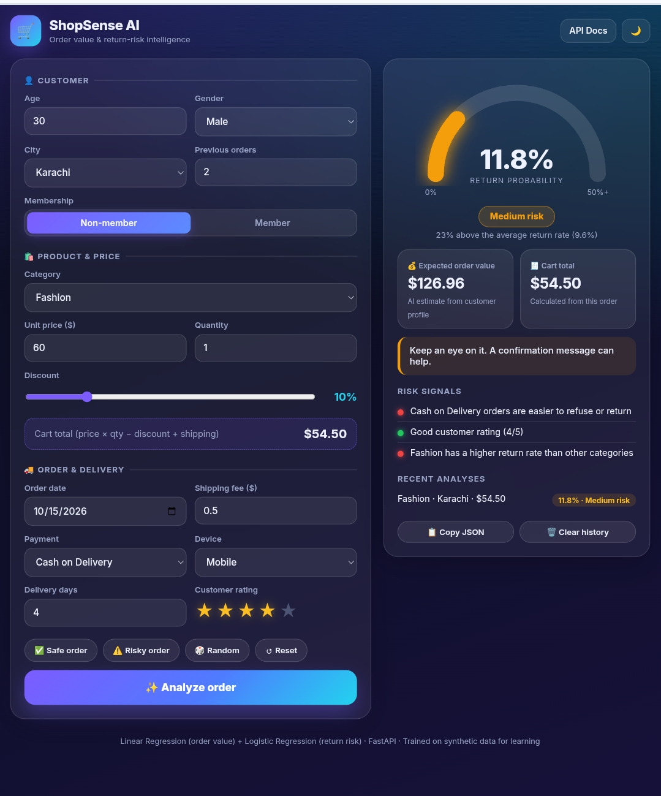

# ShopSense AI - E-Commerce Order Intelligence

A machine learning web app that predicts **order value** and **return risk** for e-commerce orders.

## Features
- Regression model (Linear Regression): estimates expected order value
- Classification model (Logistic Regression): predicts the probability an order is returned
- FastAPI backend with input validation and auto-generated docs (/docs)
- Modern dark/light dashboard UI with risk gauge, risk signals and analysis histo
  
## Tech stack
Python, pandas, scikit-learn, FastAPI, HTML/CSS/JavaScript

## Project files
- app.py : FastAPI backend and prediction logic
- index.html : dashboard UI
- ecommerce_sales.csv : synthetic dataset (5,000 orders)
- *.pkl : trained model pipelines (imputing + encoding + model)

## Run locally
    pip install -r requirements.txt
    uvicorn app:app --reload

Then open http://127.0.0.1:8000

## API example
POST /api/predict with order details as JSON. The response includes return_probability, risk_level, expected_order_value and risk signals.

## Notes
The dataset is synthetic, built for learning. Models are simple baselines, and results will differ with real data.

## Author
Rafaqat - AI automation and machine learning learner, Karak, Pakistan
